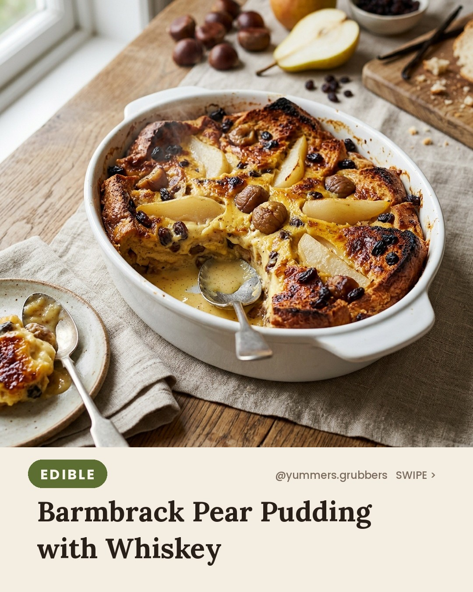
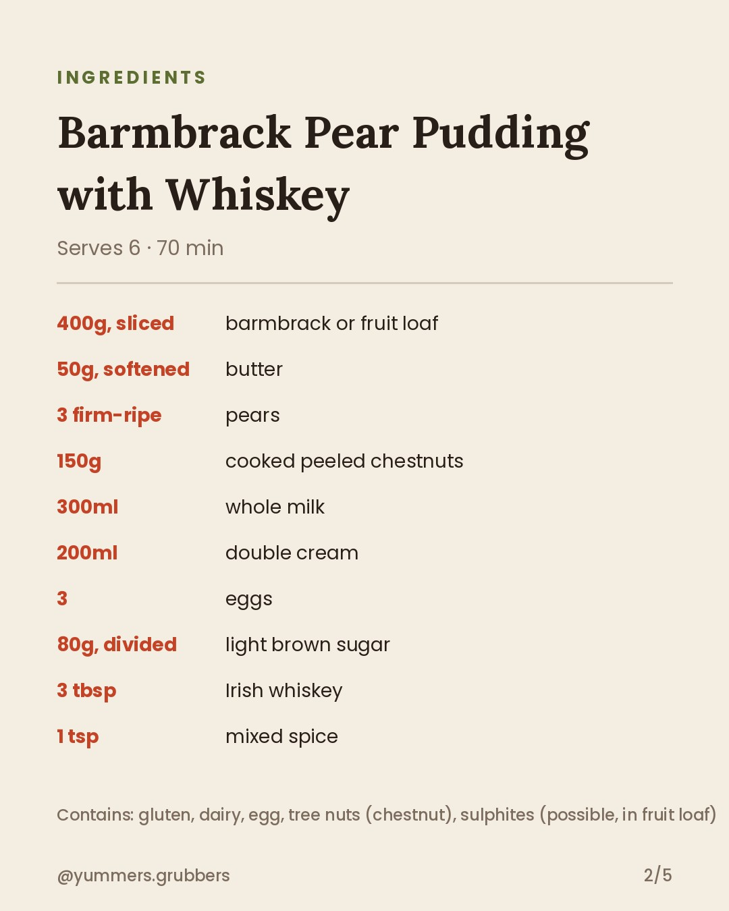
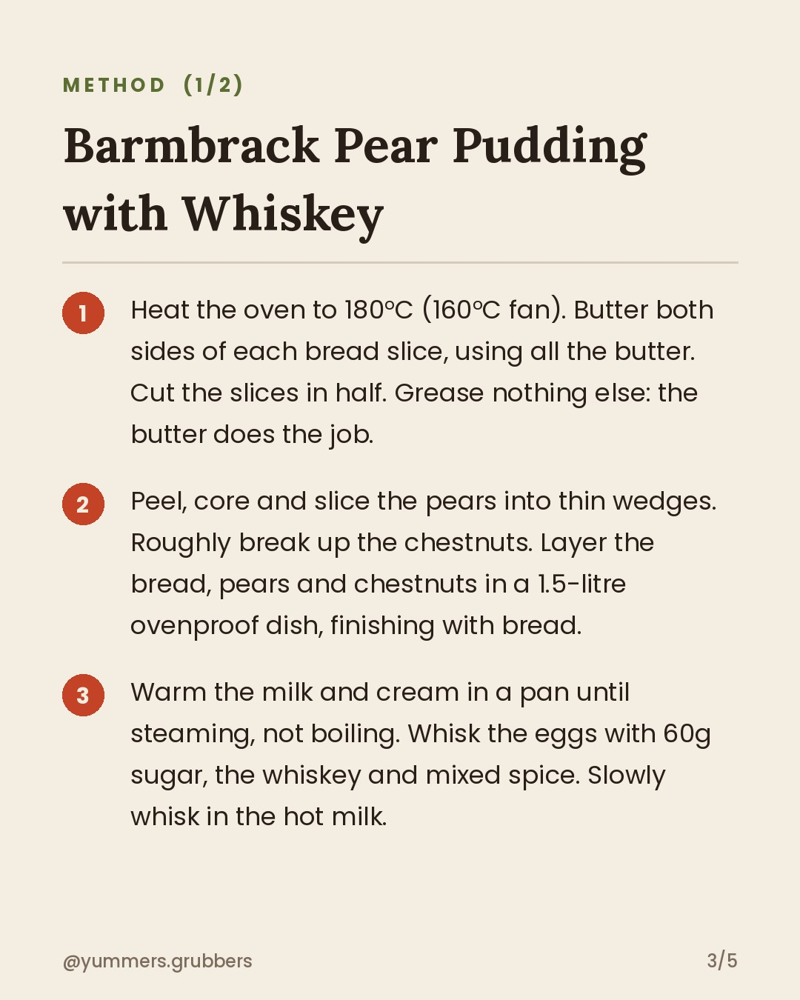
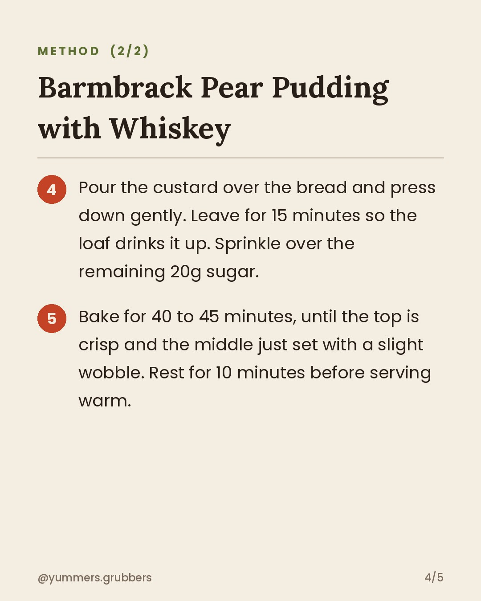

**Barmbrack Pear Pudding with Whiskey** · `edible` · 🌍 Ireland week theme

## 📲 You post this one (it's a "Yummy - Justin Bieber" day)
1. **[Download the Reel](https://v3b.fal.media/files/b/0ab0b1dd/iWTPSQQdil10EUYEw4HE3_reel.mp4)** on your phone: open the link, then Share → **Save Video**.
2. Copy the caption below.
3. Instagram (as yummers.grubbers) → ➕ → **Reel** → pick the video → **Add audio** → search **Yummy - Justin Bieber** → choose the catchy part → Next → paste the caption → **Share**.
4. Close this issue when it's live.

The bot won't post it, and you'll get a reminder at the usual posting time.

    

### Caption
```
Irish barmbrack makes a very good bread and butter pudding. Add pears, chestnuts and a splash of whiskey and it gets dangerous.
Would you pour extra custard on top, or is that greedy?

Serves 6 · 70 min
Contains: gluten, dairy, egg, tree nuts (chestnut), sulphites (possible, in fruit loaf)
Pause to read the full recipe ⏸️

#irelandfood #worldfood #irishfood #breadandbutterpudding #barmbrack #autumnbaking #pearrecipes #chestnuts #comfortpudding #yummersgrubbers #aifood #airecipes
```

**Reject:** add the `reject` label before the publish time and it will be skipped.
**Approve:** do nothing. It posts automatically.
