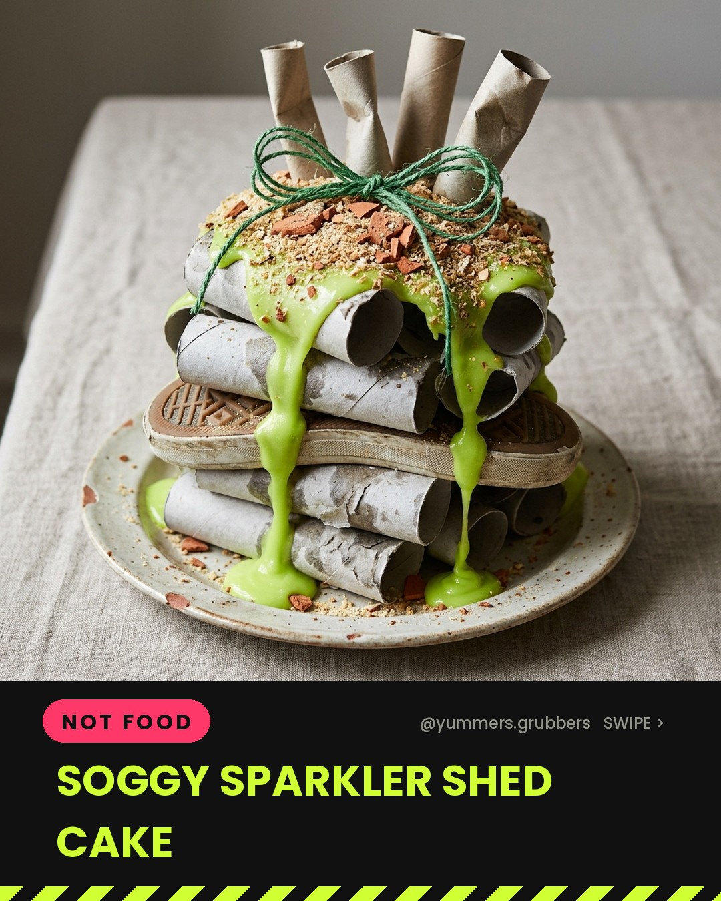
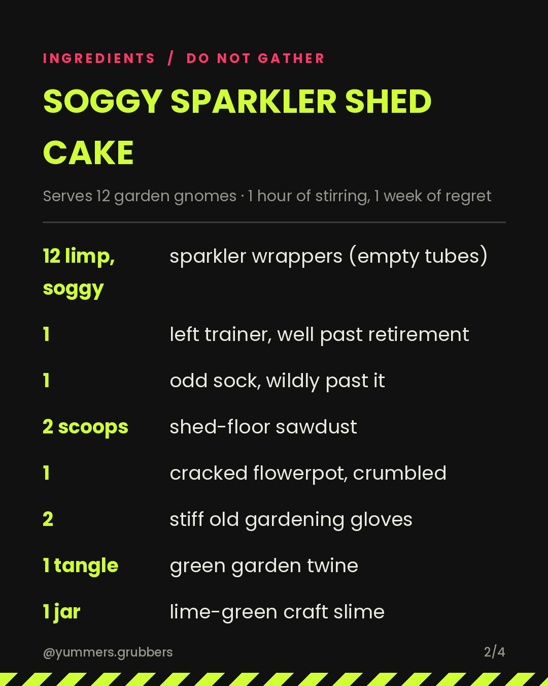
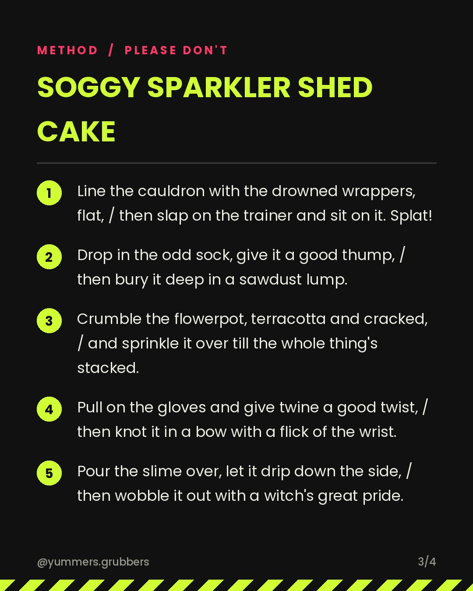

**Soggy Sparkler Shed Cake** · `not_edible` · 🎆 Bonfire Night theme

   

### Caption
```
Hop and stir the cauldron round,
In go wrappers, soggy, drowned!
Plop goes a trainer, left and grey,
Then one odd sock to join the fray.
Sprinkle sawdust from the shed,
Crumbled flowerpot, brick-red.
Squelch the gloves and twine in a knot,
Lime-green slime, a gloopy lot!
Stir it thrice and stack it tall,
The wobbliest wreck of a cake of all!

Swipe for the spell 👉

#bonfirenight #guyfawkesnight #YummersGrubbers #WitchsSpell #JokeRecipe #NotARealRecipe #ShedJunkBake #GrossFood #CauldronCakes #aifood #airecipes
```

**Reject:** add the `reject` label before the publish time and it will be skipped.
**Approve:** do nothing. It posts automatically.
