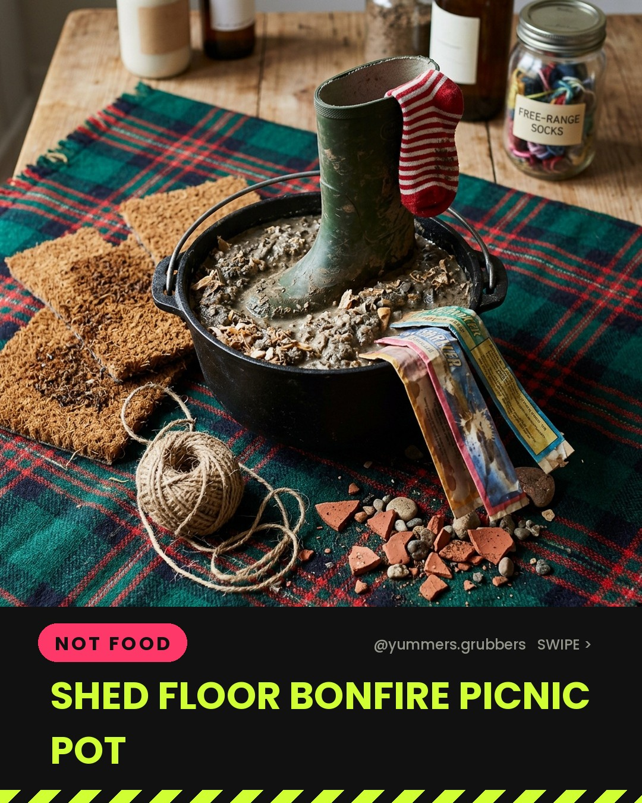
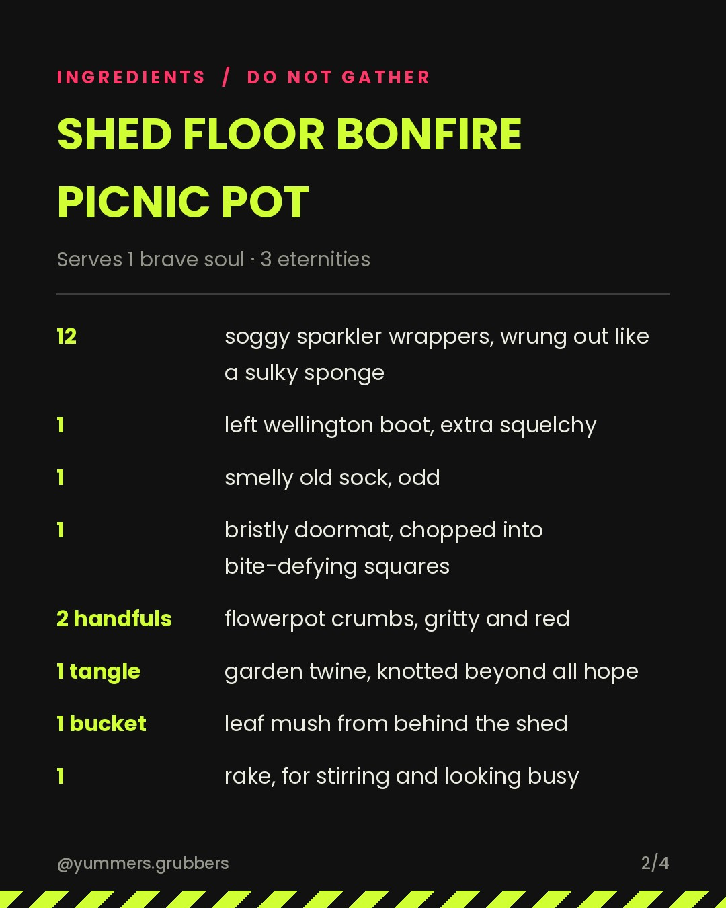
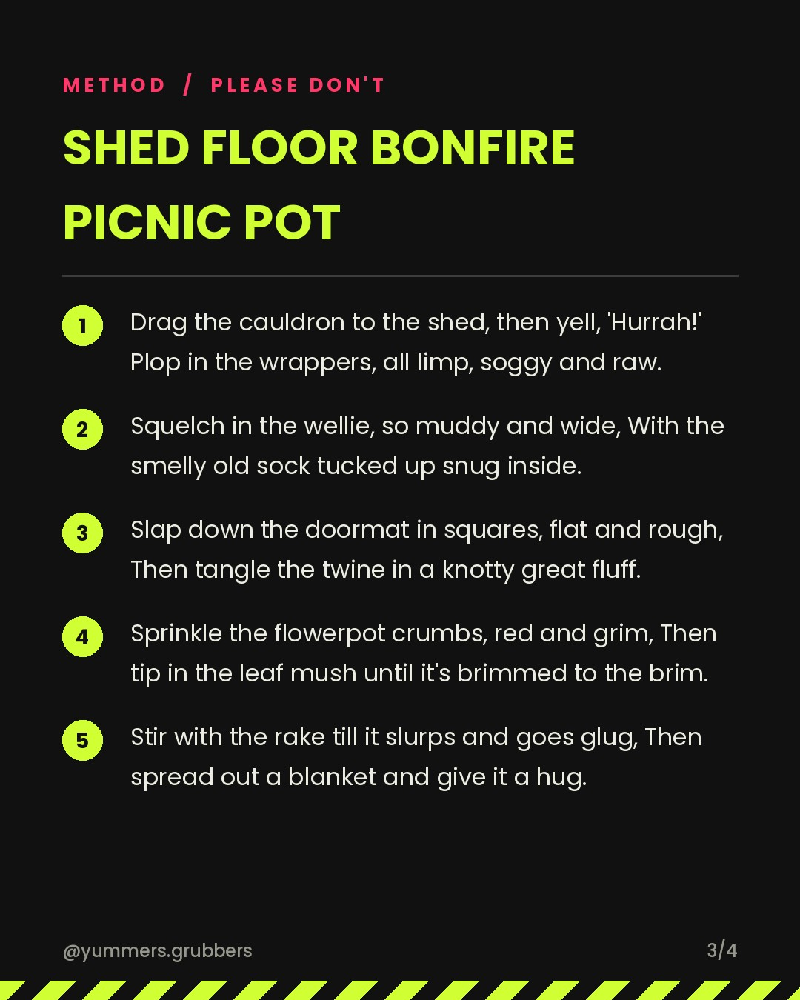

**Shed Floor Bonfire Picnic Pot** · `not_edible` · 🎆 Bonfire Night theme

   

### Caption
```
Wobble, wobble, shed-floor stew,
Soggy wrappers, plop in two!
Splat goes a wellie, mud-brown and wide,
With a smelly old sock still stuck inside.
Slap in the doormat, bristly and flat,
Then a twine-tangle lump, like a knotted-up hat.
Sprinkle the pot crumbs, gritty and red,
Add leaf-mush slime from the old garden bed.
Stir with a rake till it gloops and goes glug,
Picnic's ready. Come on, give it a hug!

Swipe for the spell 👉

#bonfirenight #guyfawkesnight #YummersGrubbers #WitchsSpell #JokeRecipe #BonfireNightPicnic #ShedJunkStew #GrossButFunny #aifood #airecipes
```

**Reject:** add the `reject` label before the publish time and it will be skipped.
**Approve:** do nothing. It posts automatically.
