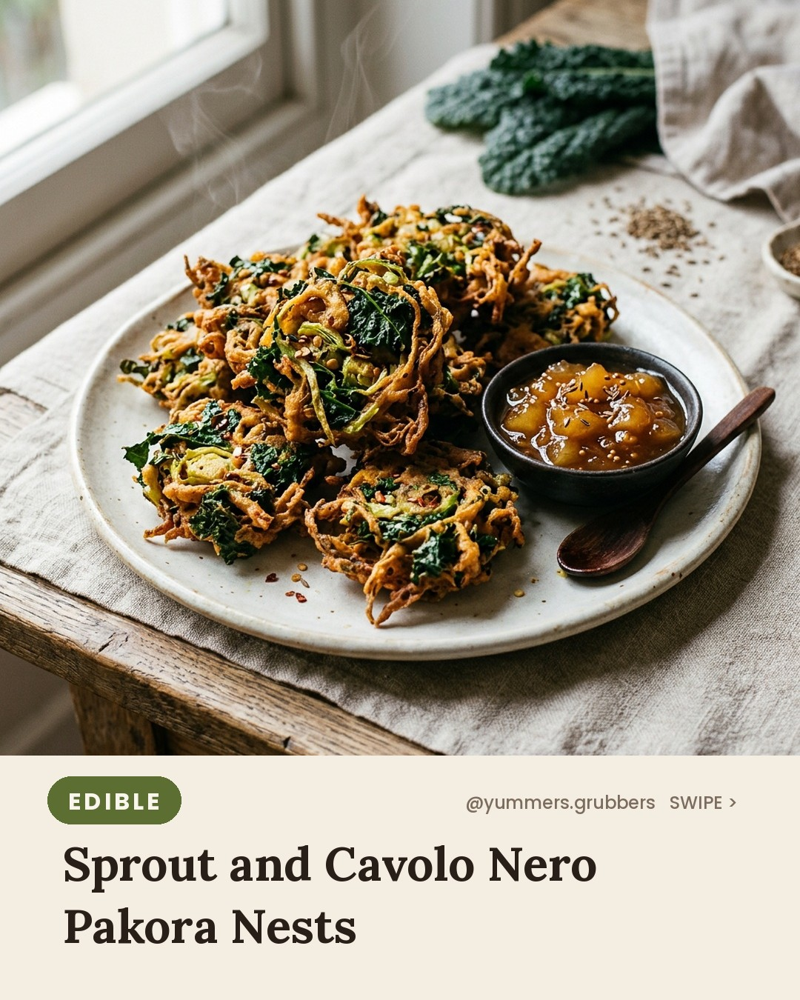
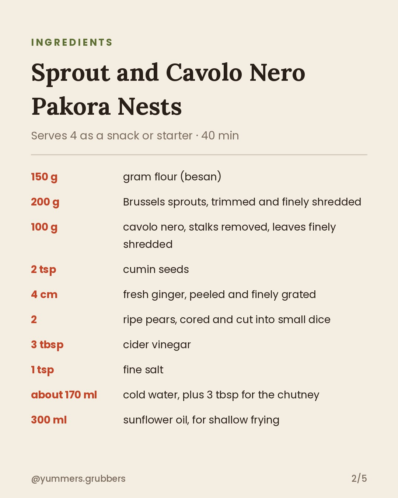
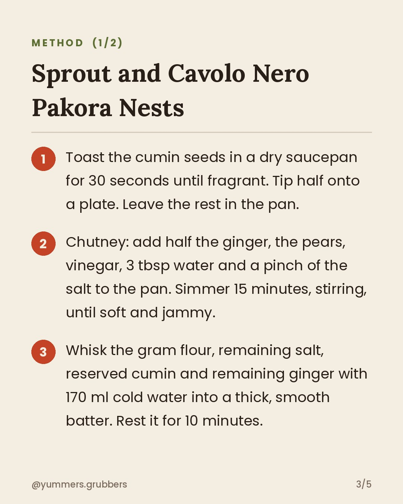
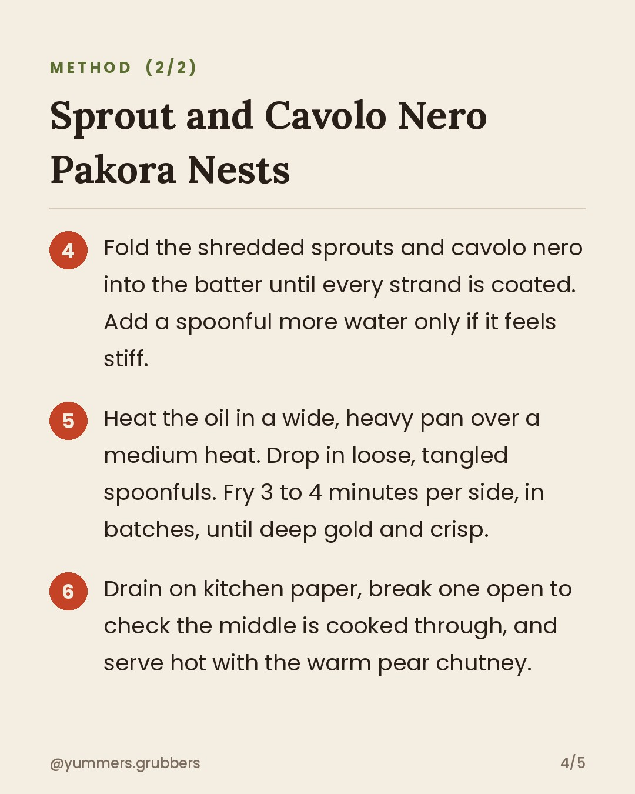

**Sprout and Cavolo Nero Pakora Nests** · `edible` · 🪔 Diwali theme

## 📲 You post this one (it's a "Yummy - Justin Bieber" day)
1. **[Download the Reel](https://v3b.fal.media/files/b/0ab19e3a/RnhiSNqbBMPPLK5LT1IDd_reel.mp4)** on your phone: open the link, then Share → **Save Video**.
2. Copy the caption below.
3. Instagram (as yummers.grubbers) → ➕ → **Reel** → pick the video → **Add audio** → search **Yummy - Justin Bieber** → choose the catchy part → Next → paste the caption → **Share**.
4. Close this issue when it's live.

The bot won't post it, and you'll get a reminder at the usual posting time.

    

### Caption
```
Brussels sprouts at a Diwali-style feast. Hear me out: shredded, battered and fried, they're the first thing to vanish.
Who's the sprout sceptic at your table?

Serves 4 as a snack or starter · 40 min
Pause to read the full recipe ⏸️

#diwali #diwalisweets #YummersGrubbers #Pakora #WinterVeg #Vegan #GlutenFree #SeasonalEating #DiwaliFood #CavoloNero #aifood #airecipes
```

**Reject:** add the `reject` label before the publish time and it will be skipped.
**Approve:** do nothing. It posts automatically.
