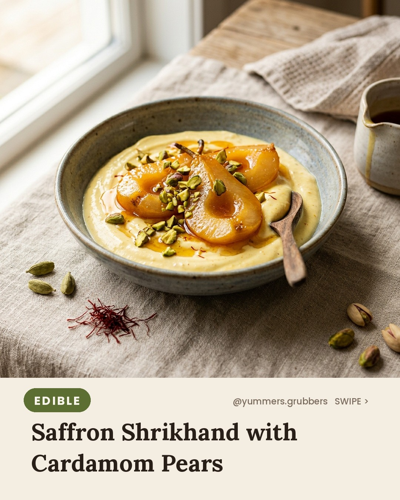
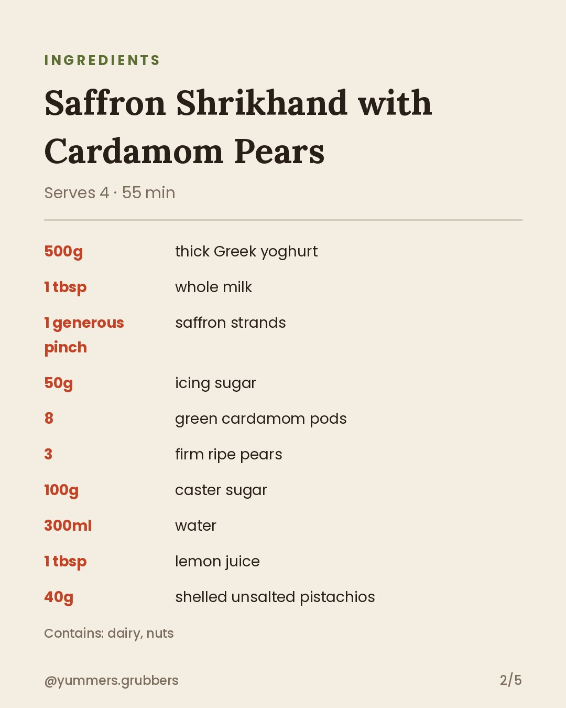
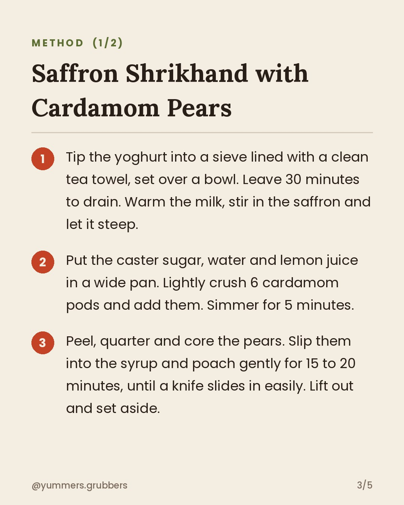
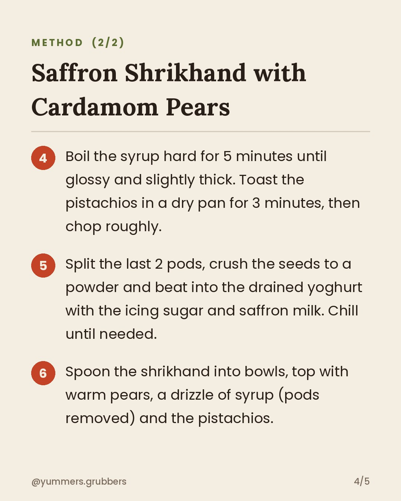

**Saffron Shrikhand with Cardamom Pears** · `edible` · 🪔 Diwali theme

## 📲 You post this one (it's a "Yummy - Justin Bieber" day)
1. **[Download the Reel](https://v3b.fal.media/files/b/0ab1c08c/pBLR1Fh4TS6g-DOJ3rIMP_reel.mp4)** on your phone: open the link, then Share → **Save Video**.
2. Copy the caption below.
3. Instagram (as yummers.grubbers) → ➕ → **Reel** → pick the video → **Add audio** → search **Yummy - Justin Bieber** → choose the catchy part → Next → paste the caption → **Share**.
4. Close this issue when it's live.

The bot won't post it, and you'll get a reminder at the usual posting time.

    

### Caption
```
Shrikhand is the pudding I'd happily eat at every Diwali table. This one gets pears, because it's autumn and they deserve a party too. Anyone else a saffron hoarder?

Serves 4 · 55 min
Contains: dairy, nuts
Pause to read the full recipe ⏸️

#diwali #diwalisweets #Shrikhand #PearRecipes #AutumnDesserts #Cardamom #YummersGrubbers #EasyDessert #aifood #airecipes
```

**Reject:** add the `reject` label before the publish time and it will be skipped.
**Approve:** do nothing. It posts automatically.
