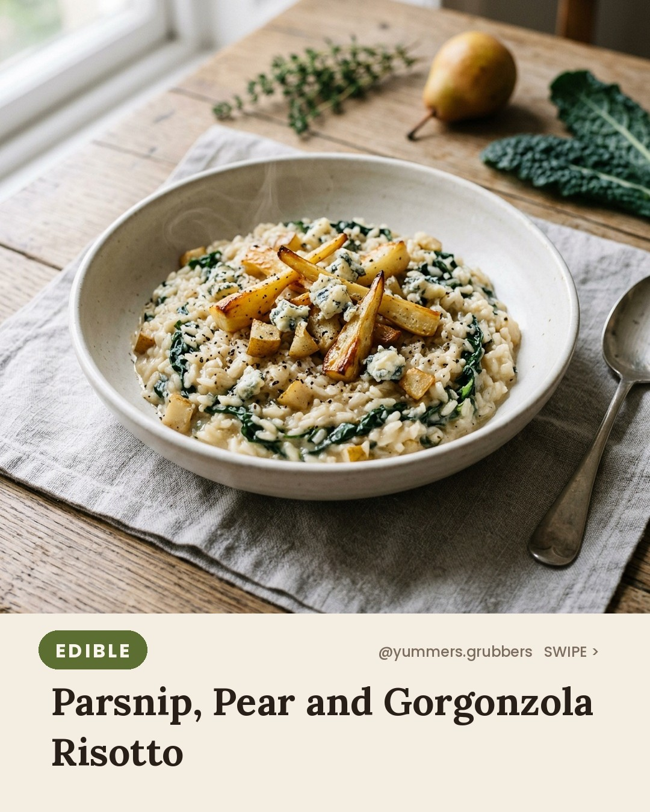
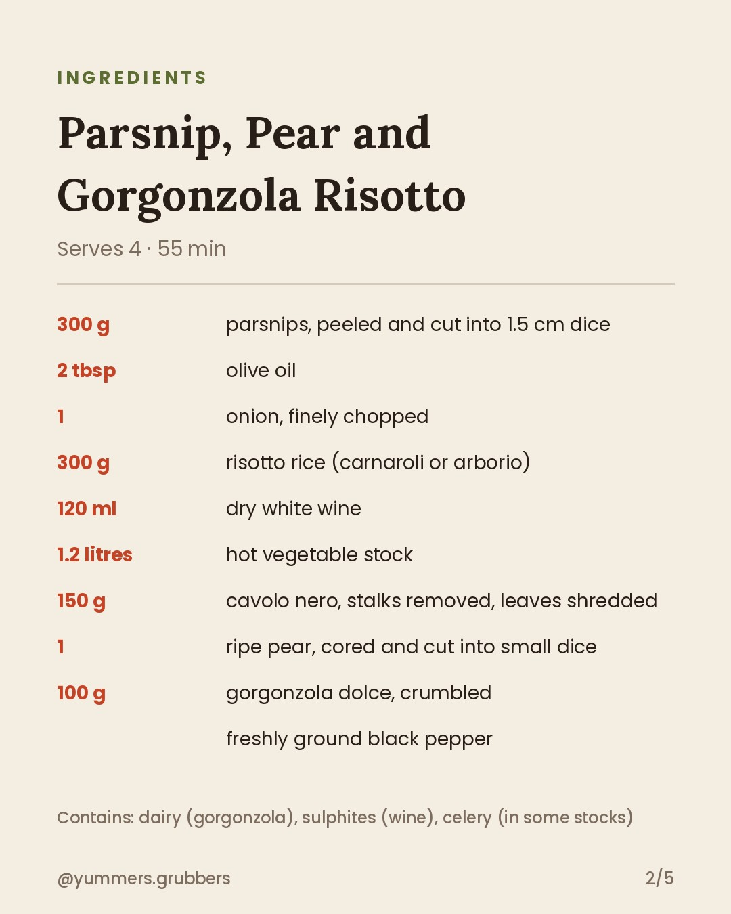
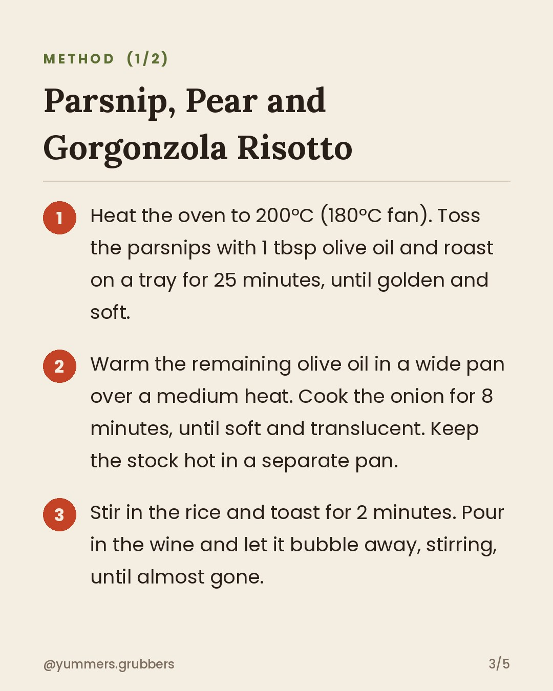
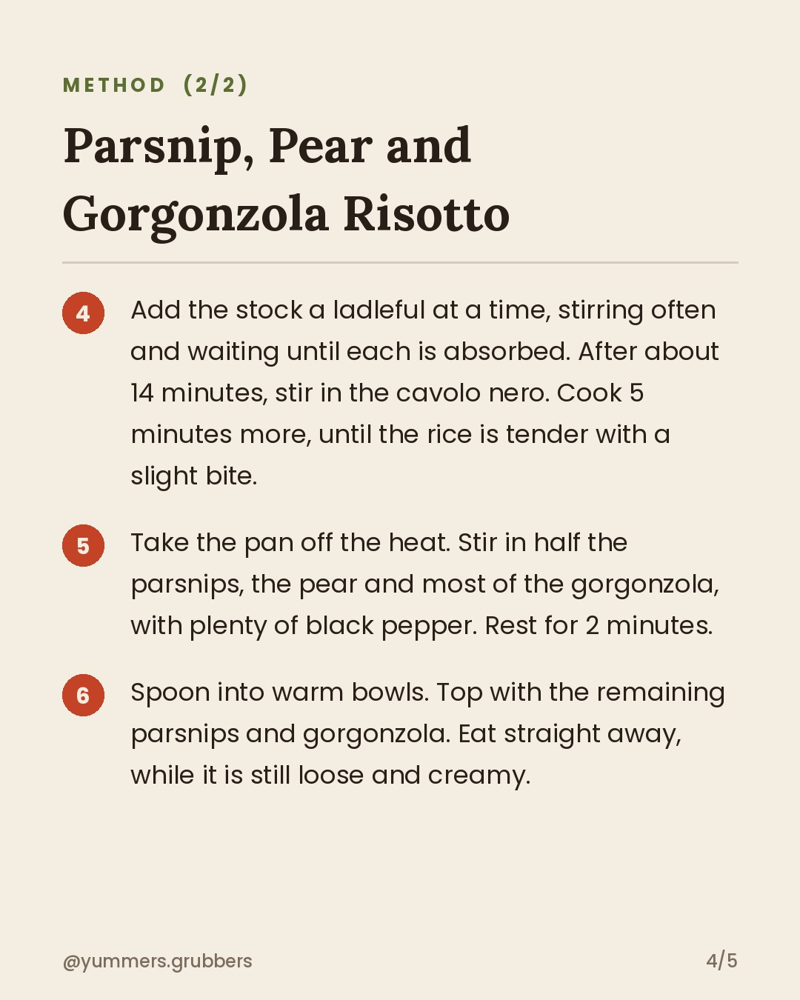

**Parsnip, Pear and Gorgonzola Risotto** · `edible` · 🌍 Italy week theme

## 📲 You post this one (it's a "Yummy - Justin Bieber" day)
1. **[Download the Reel](https://v3b.fal.media/files/b/0ab1e20f/75GGVFp2r6apaPskSQJ3x_reel.mp4)** on your phone: open the link, then Share → **Save Video**.
2. Copy the caption below.
3. Instagram (as yummers.grubbers) → ➕ → **Reel** → pick the video → **Add audio** → search **Yummy - Justin Bieber** → choose the catchy part → Next → paste the caption → **Share**.
4. Close this issue when it's live.

The bot won't post it, and you'll get a reminder at the usual posting time.

    

### Caption
```
Italy week, and we're in the north with a risotto that takes the pear-and-gorgonzola classic somewhere cosier. Roast parsnips and cavolo nero do the heavy lifting. Would you add the pear, or is fruit in risotto a step too far?

Serves 4 · 55 min
Contains: dairy (gorgonzola), sulphites (wine), celery (in some stocks)
Pause to read the full recipe ⏸️

#italyfood #worldfood #ItalyWeek #Risotto #WinterComfort #Parsnip #CavoloNero #SeasonalEating #HomeCooking #YummersGrubbers #aifood #airecipes
```

**Reject:** add the `reject` label before the publish time and it will be skipped.
**Approve:** do nothing. It posts automatically.
