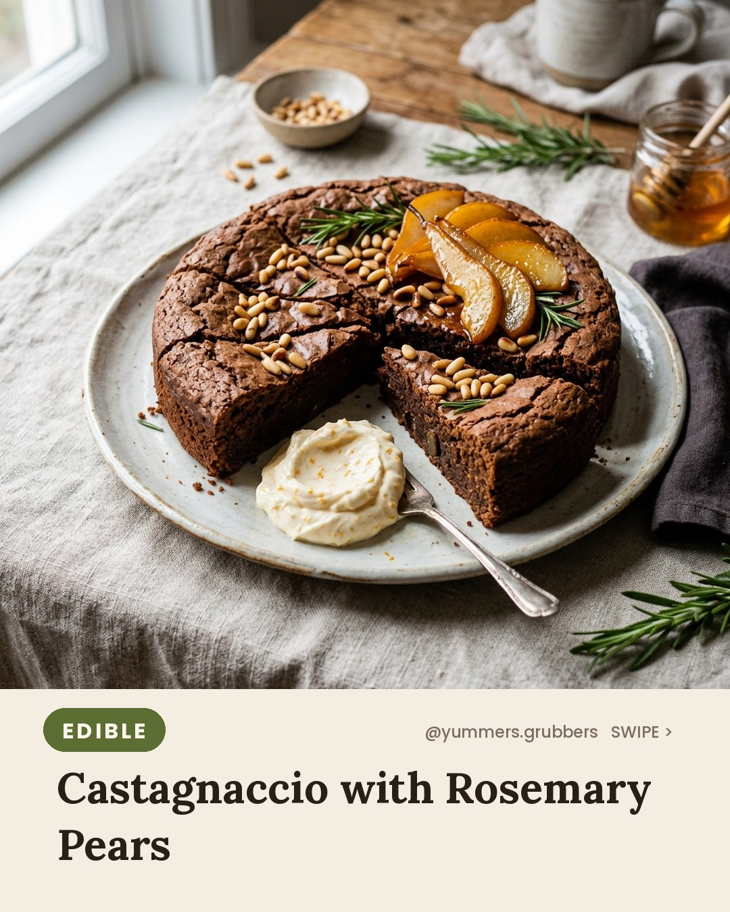
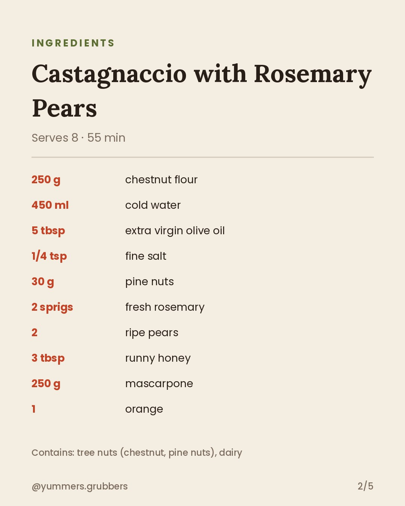
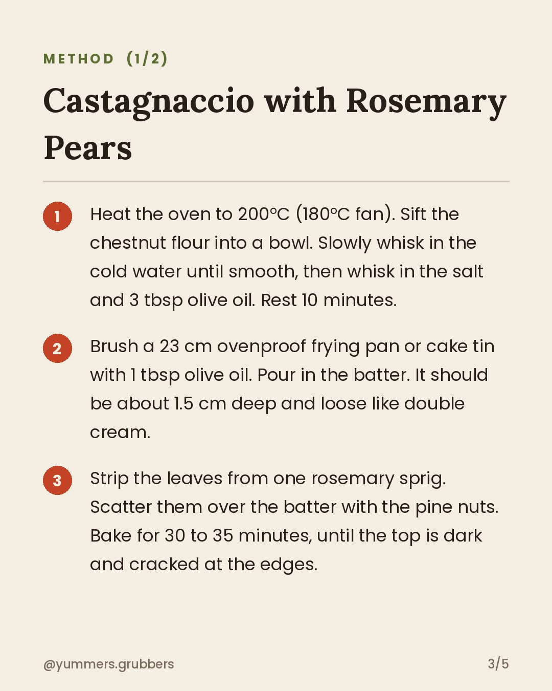
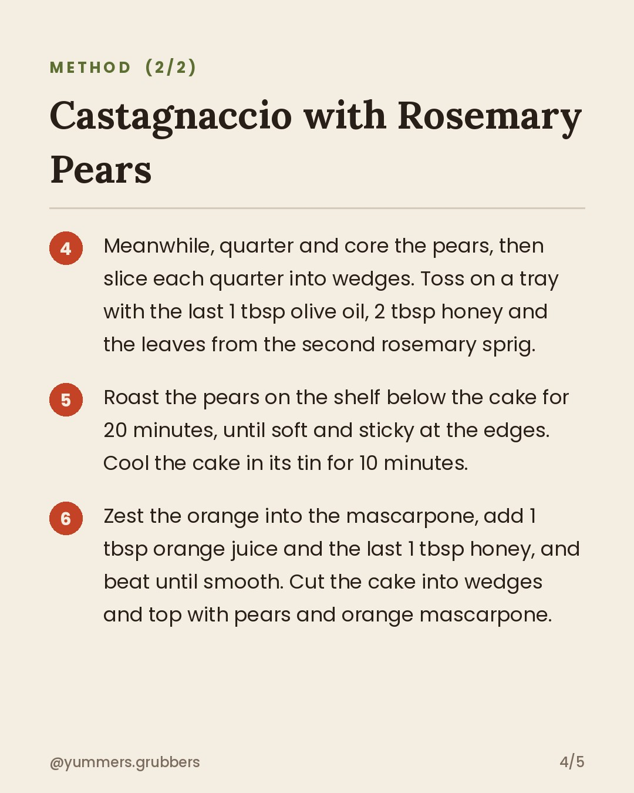
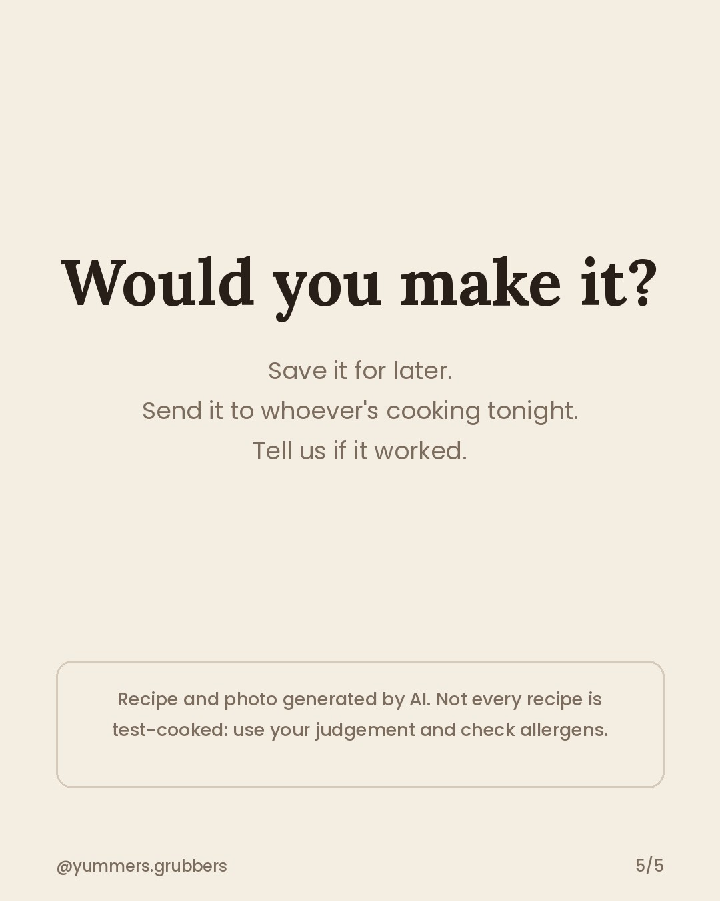

**Castagnaccio with Rosemary Pears** · `edible` · 🌍 Italy week theme

## 📲 You post this one (it's a "Yummy - Justin Bieber" day)
1. **[Download the Reel](https://v3b.fal.media/files/b/0ab22596/Sy5J_oSNZQlD6WyAxwKub_reel.mp4)** on your phone: open the link, then Share → **Save Video**.
2. Copy the caption below.
3. Instagram (as yummers.grubbers) → ➕ → **Reel** → pick the video → **Add audio** → search **Yummy - Justin Bieber** → choose the catchy part → Next → paste the caption → **Share**.
4. Close this issue when it's live.

The bot won't post it, and you'll get a reminder at the usual posting time.

    

### Caption
```
This is castagnaccio, the humble chestnut cake Tuscan grandmothers bake every autumn. No sugar, no eggs, lots of olive oil. We've added pears and orange cream because we're polite, not strict. Who else grew up thinking chestnut flour was a bit weird?

Serves 8 · 55 min
Contains: tree nuts (chestnut, pine nuts), dairy
Pause to read the full recipe ⏸️

#italyfood #worldfood #castagnaccio #ItalianDessert #ChestnutFlour #PearRecipes #AutumnBaking #TuscanFood #GlutenFreeBake #YummersGrubbers #aifood #airecipes
```

**Reject:** add the `reject` label before the publish time and it will be skipped.
**Approve:** do nothing. It posts automatically.
