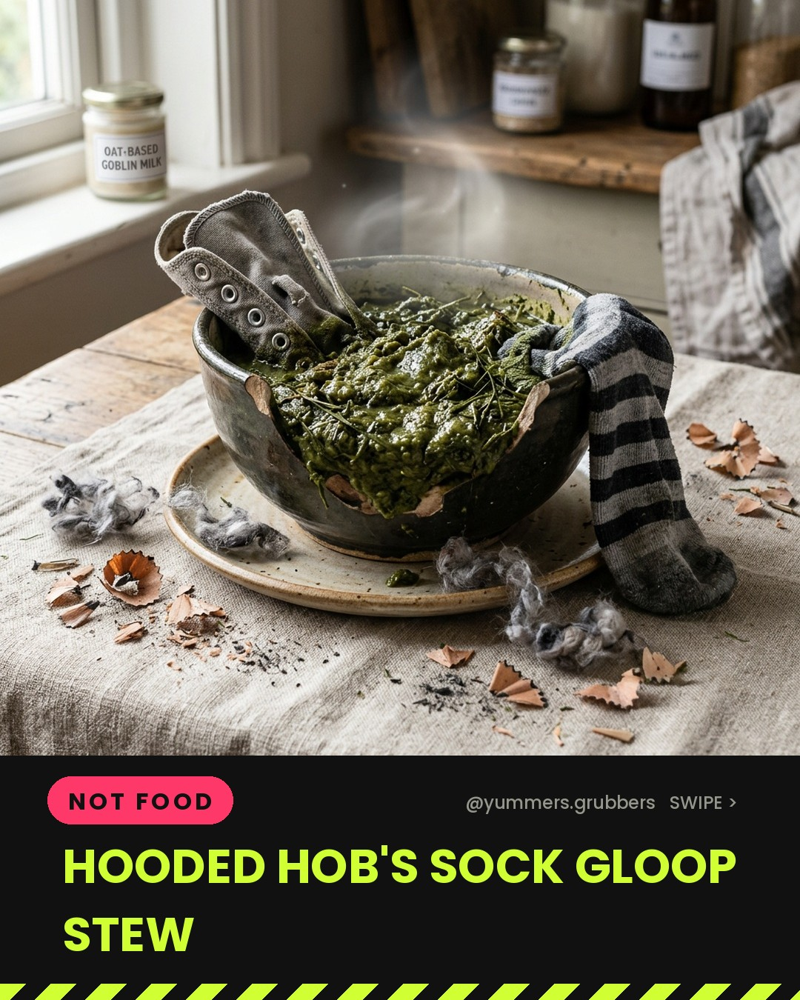
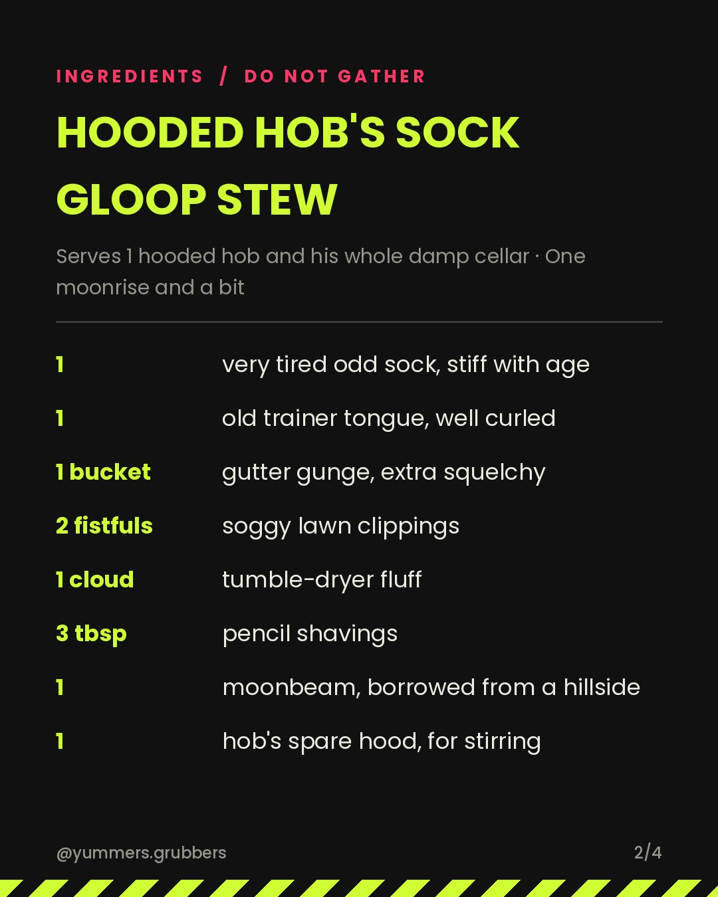
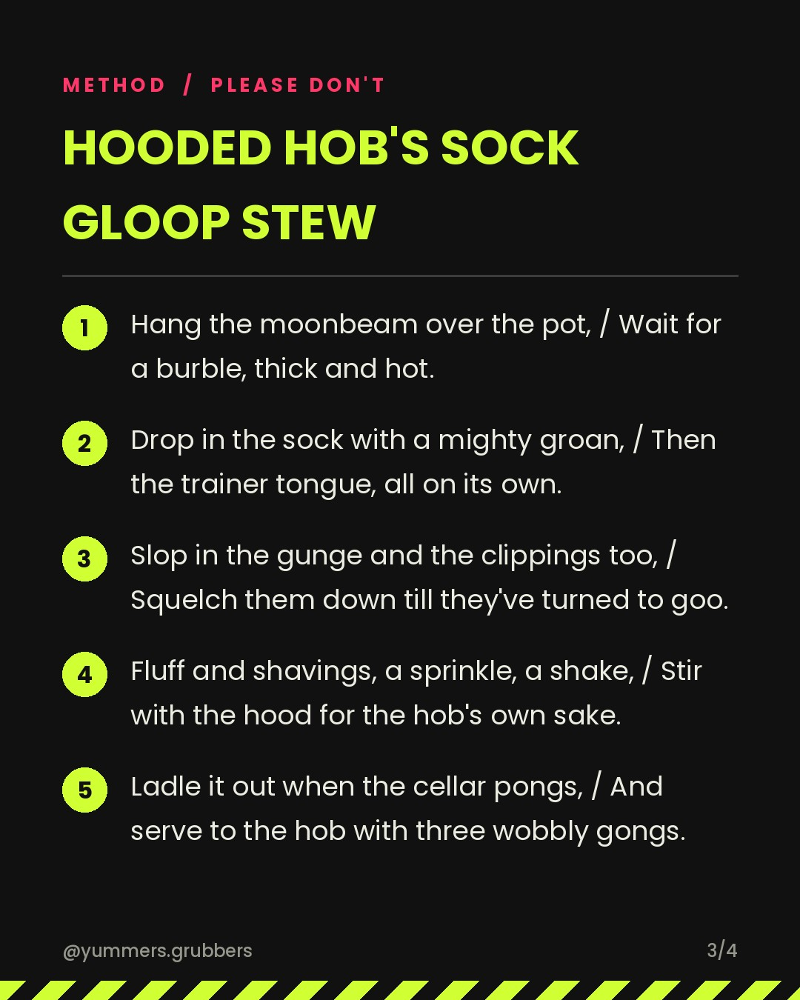

**Hooded Hob's Sock Gloop Stew** · `not_edible` · 🌍 Italy week theme

   

### Caption
```
Hop to the pot, little hob in the hood,
Drop in a sock that is far from good!
Plop goes a trainer tongue, curly and grey,
Slap goes the gutter gunge, hip hip hooray!
Tip in the lawn clippings, soggy and green,
Fluff from the dryer, the fluffiest seen!
Shake in pencil shavings, a sprinkly stack,
Stir till the gloop gives a gurgle right back!
Round goes the spoon and the cellar goes pong,
Hob's midnight stew is a thick sticky song!

Swipe for the spell 👉

#italyfood #worldfood #YummersGrubbers #WitchsSpell #JokeRecipe #ItalyWeek #FolkloreFood #SockStew #GrossOut #CauldronCooking #aifood #airecipes
```

**Reject:** add the `reject` label before the publish time and it will be skipped.
**Approve:** do nothing. It posts automatically.
