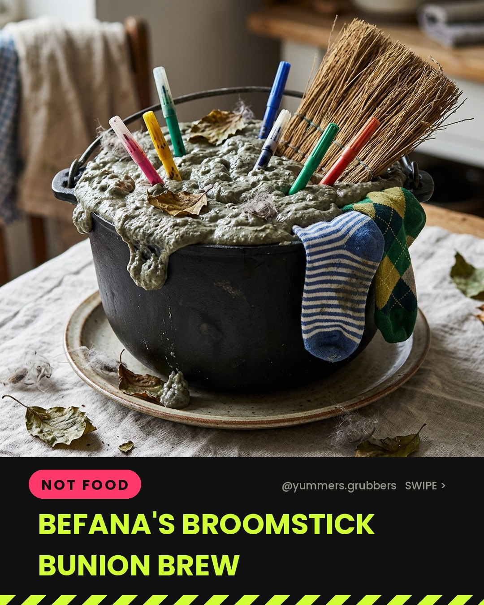
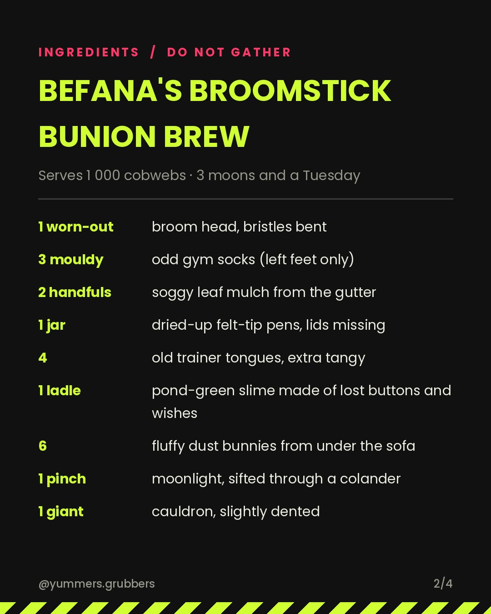
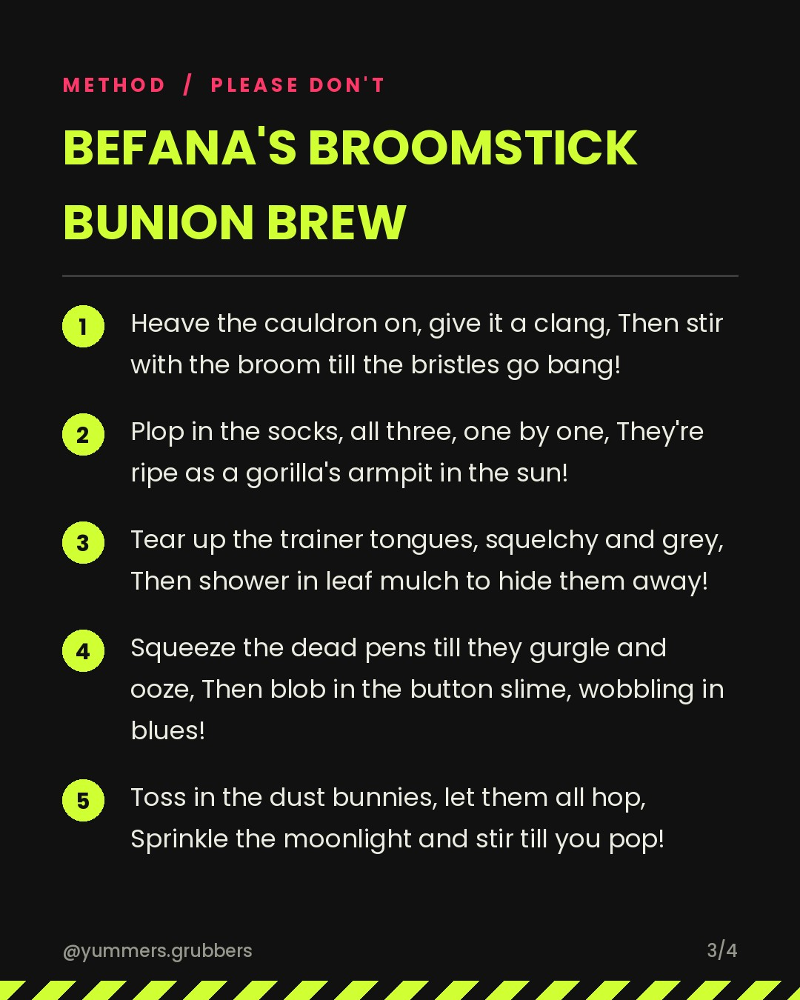

**Befana's Broomstick Bunion Brew** · `not_edible` · 🌍 Italy week theme

   

### Caption
```
Bubble and bumble, my cauldron's a-grumble,
In goes a broom head, all bristly and humble!
Three smelly socks, left feet, ripe and rank,
Plop! Down they go with a gloopy old clank!
Trainer tongues, soggy, all tangy and green,
Slap in the slimiest slurp ever seen!
Dust bunnies bounce in, a fluffy grey crowd,
Stir with a cackle, a-ha-ha, out loud!
A sprinkle of moonlight, a button-slime dollop,
Brew up the bunion brew, glorp, glop and wallop!

Swipe for the spell 👉

#italyfood #worldfood #WitchsSpell #JokeRecipe #ItalyWeek #GrossOut #CauldronBrew #YummersGrubbers #SpookyKitchen #NotForEating #aifood #airecipes
```

**Reject:** add the `reject` label before the publish time and it will be skipped.
**Approve:** do nothing. It posts automatically.
