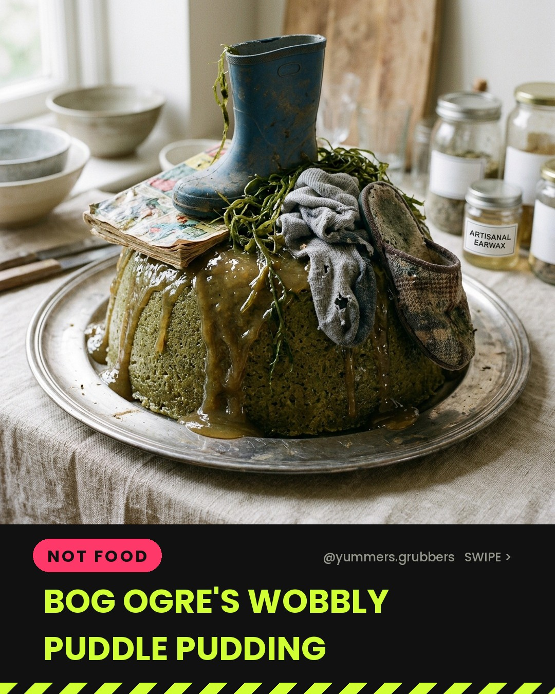
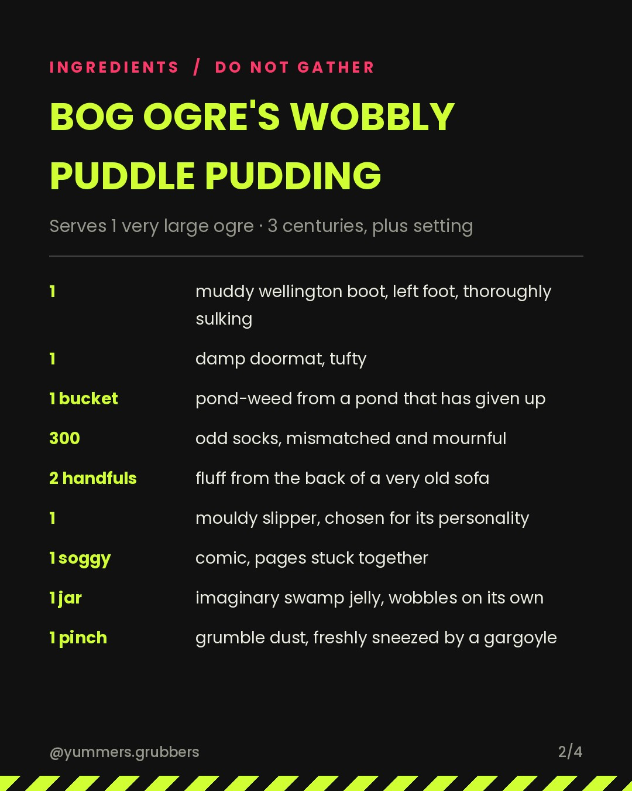
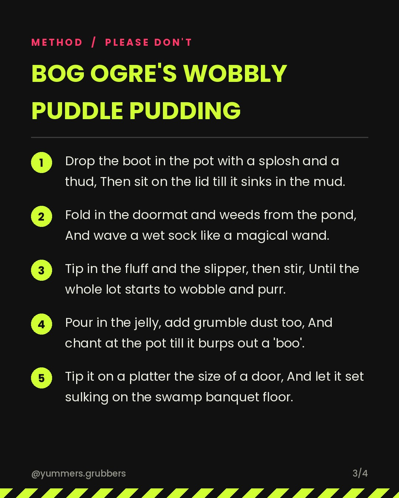

**Bog Ogre's Wobbly Puddle Pudding** · `not_edible`

   

### Caption
```
Into the cauldron, a muddy old boot,
Squelch it down deep till it gives a wet hoot!
Add one damp doormat, all tufty and brown,
And a bucket of pond-weed that's hung upside down.
Toss in three hundred odd socks, sad and grey,
With a mountain of lint that's been hiding away.
Stir in a slipper that's mouldered with age,
And a soggy old comic, page after page.
Now wobble it, jiggle it, tip it with glee:
A pudding of puddle for ogres like me!

Swipe for the spell 👉

#YummersGrubbers #JokeRecipe #WitchsSpell #SwampBanquet #GrossOutDessert #NotForEating #FairyTaleFood #aifood #airecipes
```

**Reject:** add the `reject` label before the publish time and it will be skipped.
**Approve:** do nothing. It posts automatically.
