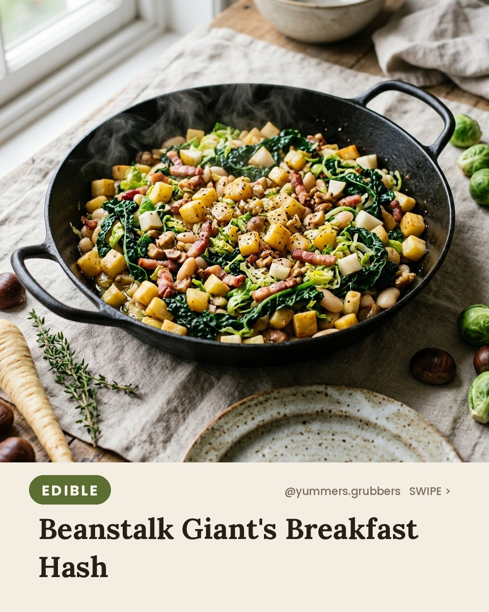
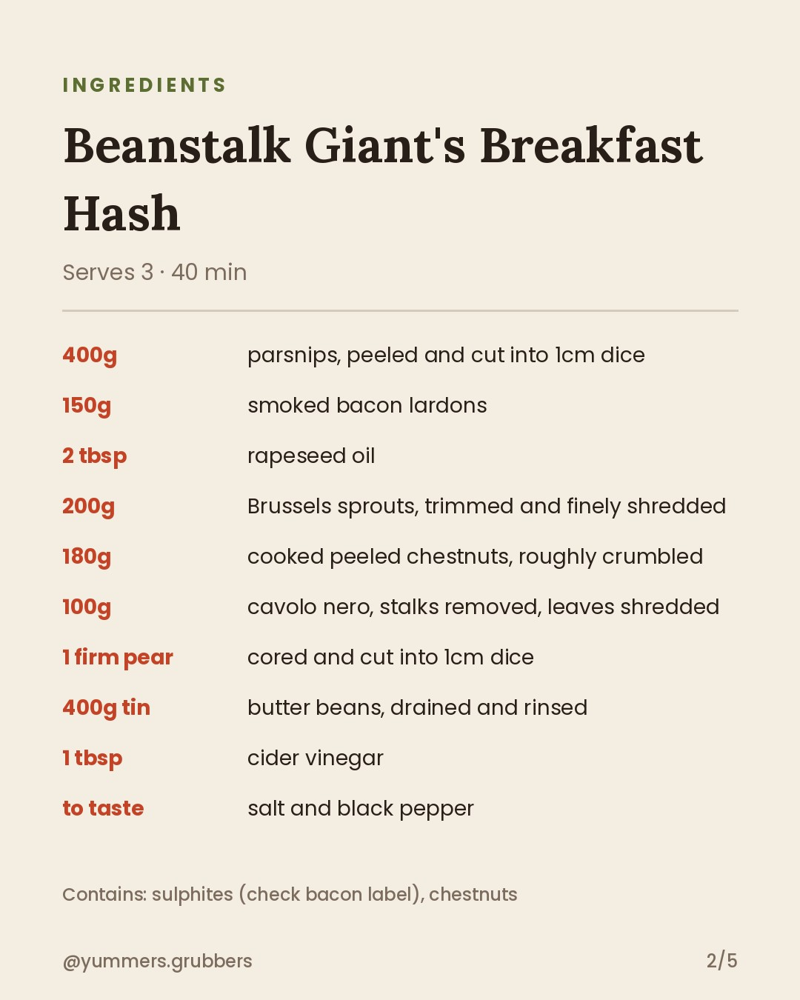
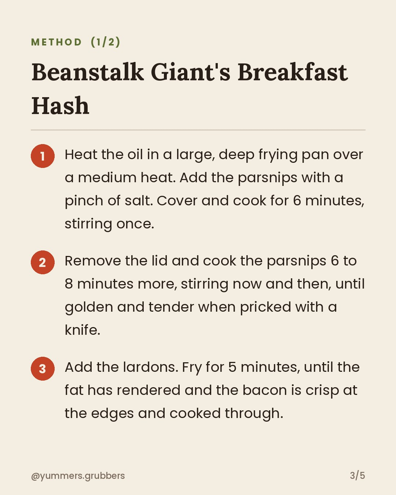
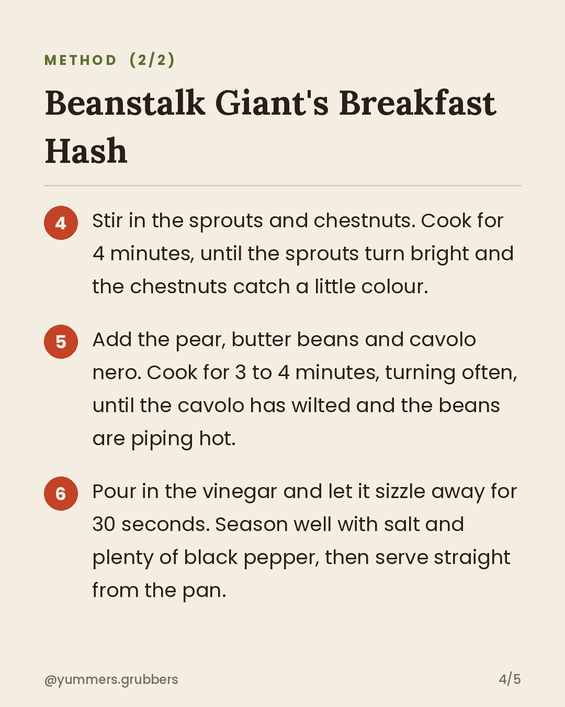
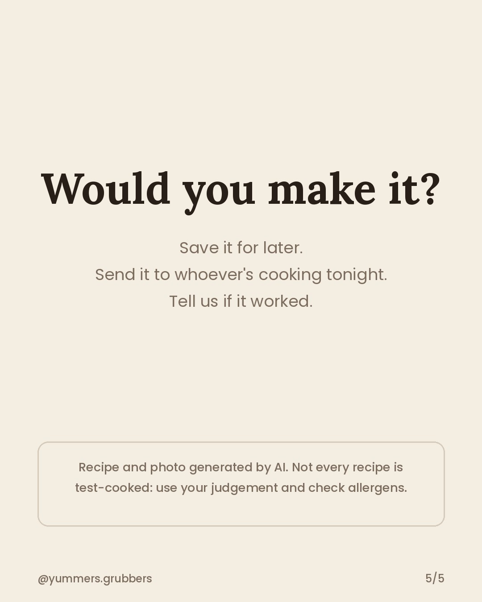

**Beanstalk Giant's Breakfast Hash** · `edible`

## 📲 You post this one (it's a "Yummy - Justin Bieber" day)
1. **[Download the Reel](https://v3b.fal.media/files/b/0ab2f01c/9OiGzqi2ps-mn239tHb70_reel.mp4)** on your phone: open the link, then Share → **Save Video**.
2. Copy the caption below.
3. Instagram (as yummers.grubbers) → ➕ → **Reel** → pick the video → **Add audio** → search **Yummy - Justin Bieber** → choose the catchy part → Next → paste the caption → **Share**.
4. Close this issue when it's live.

The bot won't post it, and you'll get a reminder at the usual posting time.

    

### Caption
```
Jack's giant ate breakfast the size of a haystack. We've taken the idea, kept the beans and lost the lumbering. Would you add a fried egg on top, or leave well alone?

Serves 3 · 40 min
Contains: sulphites (check bacon label), chestnuts
Pause to read the full recipe ⏸️

#YummersGrubbers #BreakfastHash #SeasonalEating #CavoloNero #Parsnips #Chestnuts #OnePanMeal #BritishFood #aifood #airecipes
```

**Reject:** add the `reject` label before the publish time and it will be skipped.
**Approve:** do nothing. It posts automatically.
