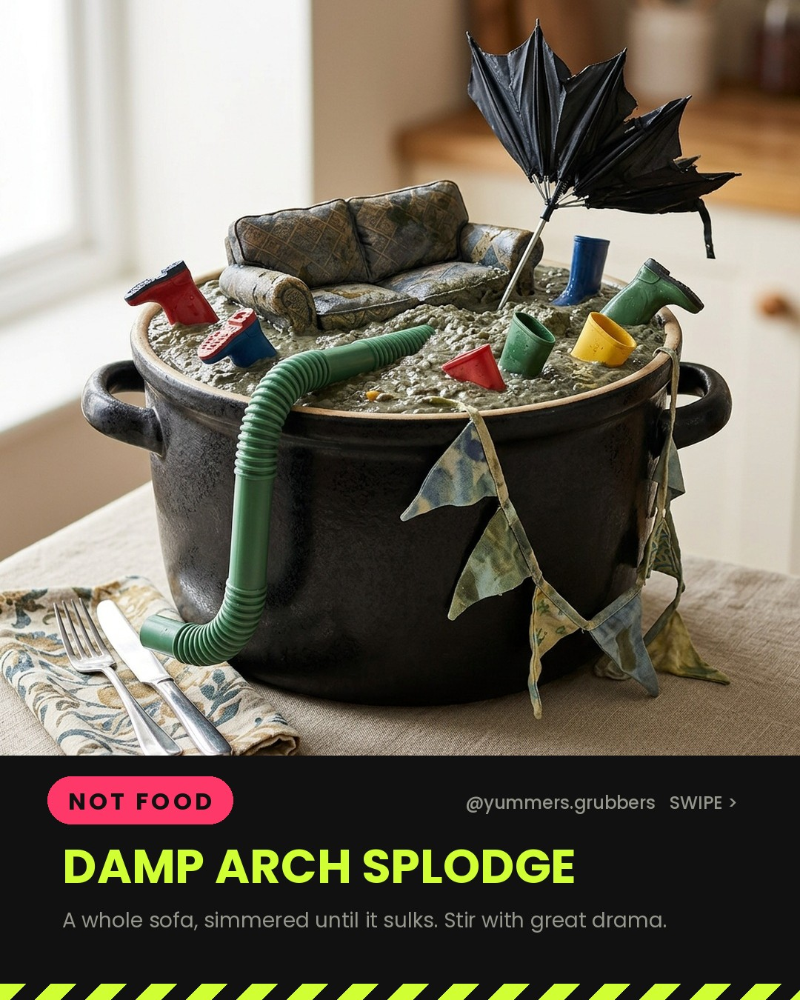
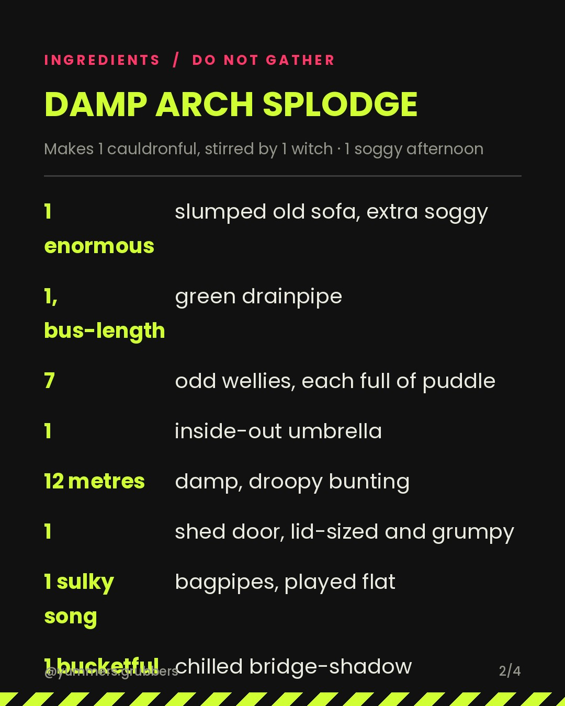
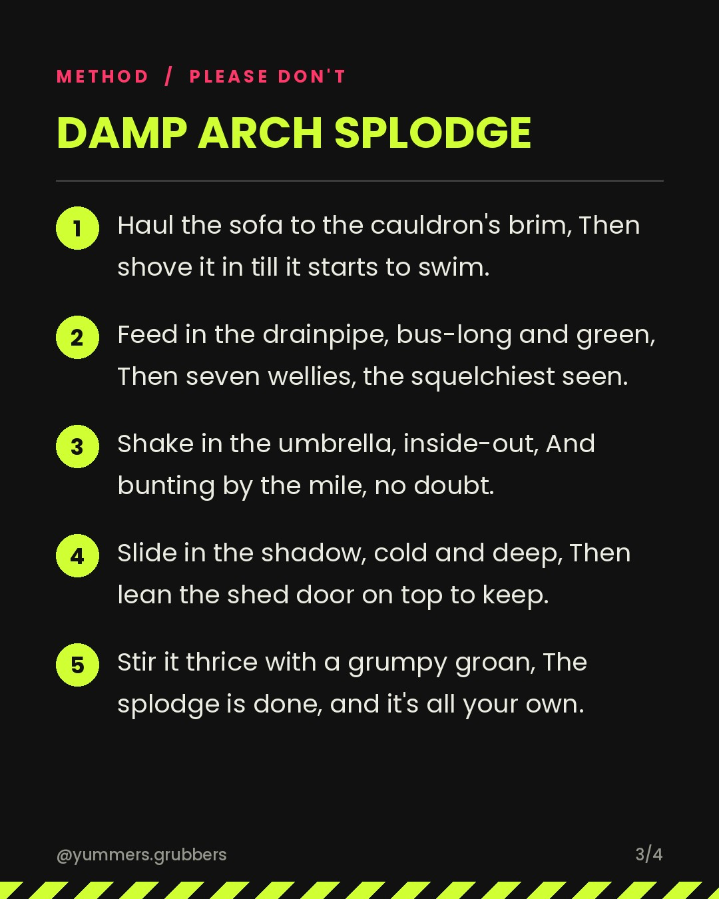

**Damp Arch Splodge** · `not_edible`

   

### Caption
```
Splish and splosh and bubble-bump,
In goes a sofa, soggy and slumped.
Drip in a drainpipe, green and long,
Stir in a bagpipe's sulky song.
Seven wellies, wet and squelchy,
One umbrella, inside-out and belchy.
Fetch a shed door, flat and grim,
Add a bridge-shadow, cold and dim.
Stir it thrice and stamp your feet,
The grumbliest splodge you'll ever meet!

Swipe for the spell 👉

#WitchsSpell #JokeRecipe #CauldronCapers #YummersGrubbers #GrossButFunny #SpellBook #aifood #airecipes
```

**Reject:** add the `reject` label before the publish time and it will be skipped.
**Approve:** do nothing. It posts automatically.
