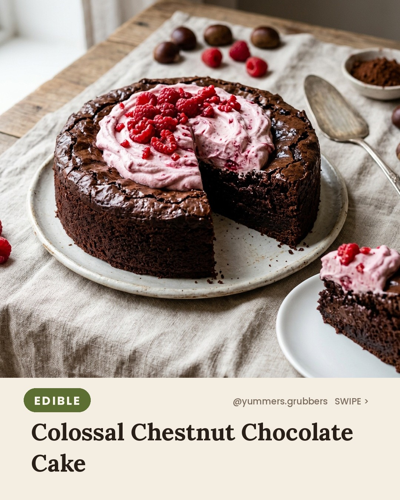
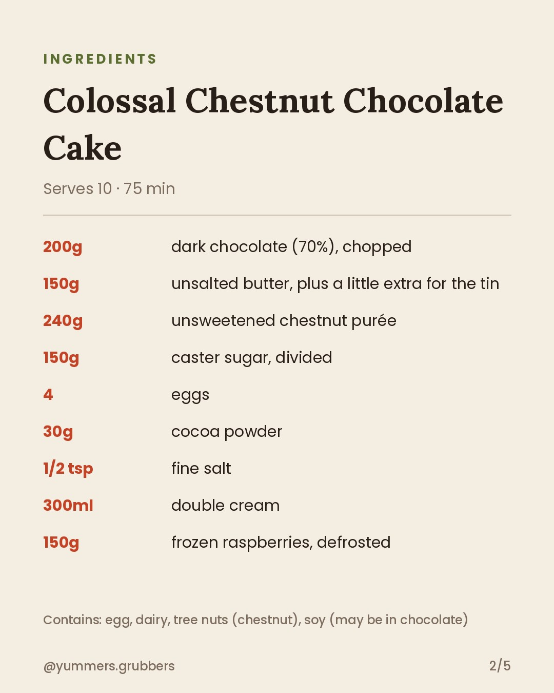
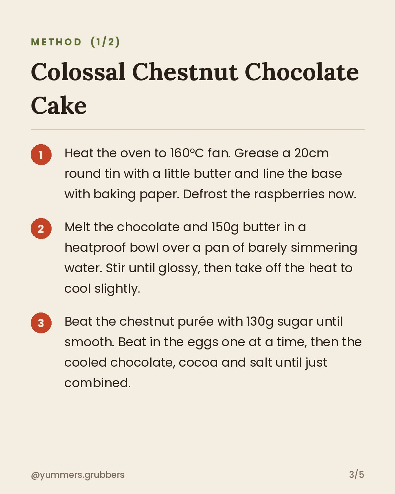
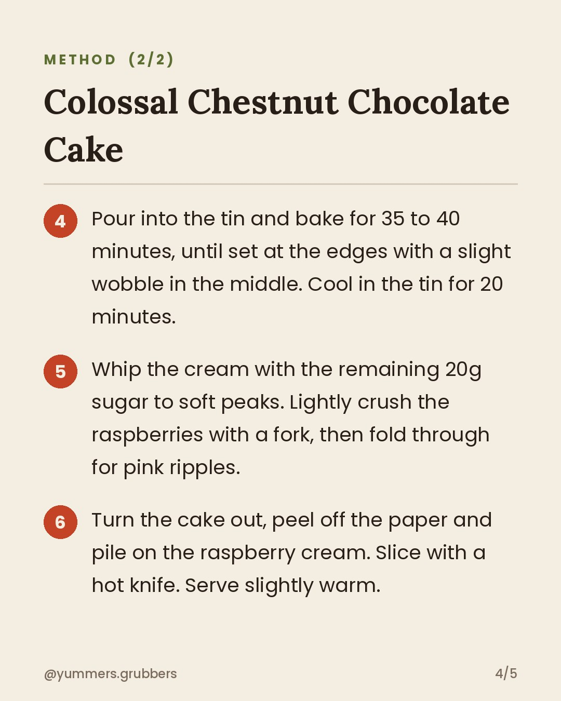
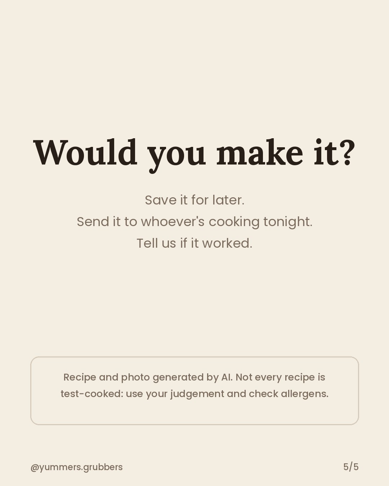

**Colossal Chestnut Chocolate Cake** · `edible`

## 📲 You post this one (it's a "Yummy - Justin Bieber" day)
1. **[Download the Reel](https://v3b.fal.media/files/b/0ab3339a/W0eqJFKfuuJ-5eWijX_pn_reel.mp4)** on your phone: open the link, then Share → **Save Video**.
2. Copy the caption below.
3. Instagram (as yummers.grubbers) → ➕ → **Reel** → pick the video → **Add audio** → search **Yummy - Justin Bieber** → choose the catchy part → Next → paste the caption → **Share**.
4. Close this issue when it's live.

The bot won't post it, and you'll get a reminder at the usual posting time.

    

### Caption
```
A cake so chocolatey it should come with its own weather warning. Roald Dahl would have asked for a second slice. Who's brave enough to go back for thirds?

Serves 10 · 75 min
Contains: egg, dairy, tree nuts (chestnut), soy (may be in chocolate)
Pause to read the full recipe ⏸️

#chocolatecake #chestnut #winterbaking #britishbaking #glutenfreeish #dessertoftheday #yummersgrubbers #aifood #airecipes
```

**Reject:** add the `reject` label before the publish time and it will be skipped.
**Approve:** do nothing. It posts automatically.
