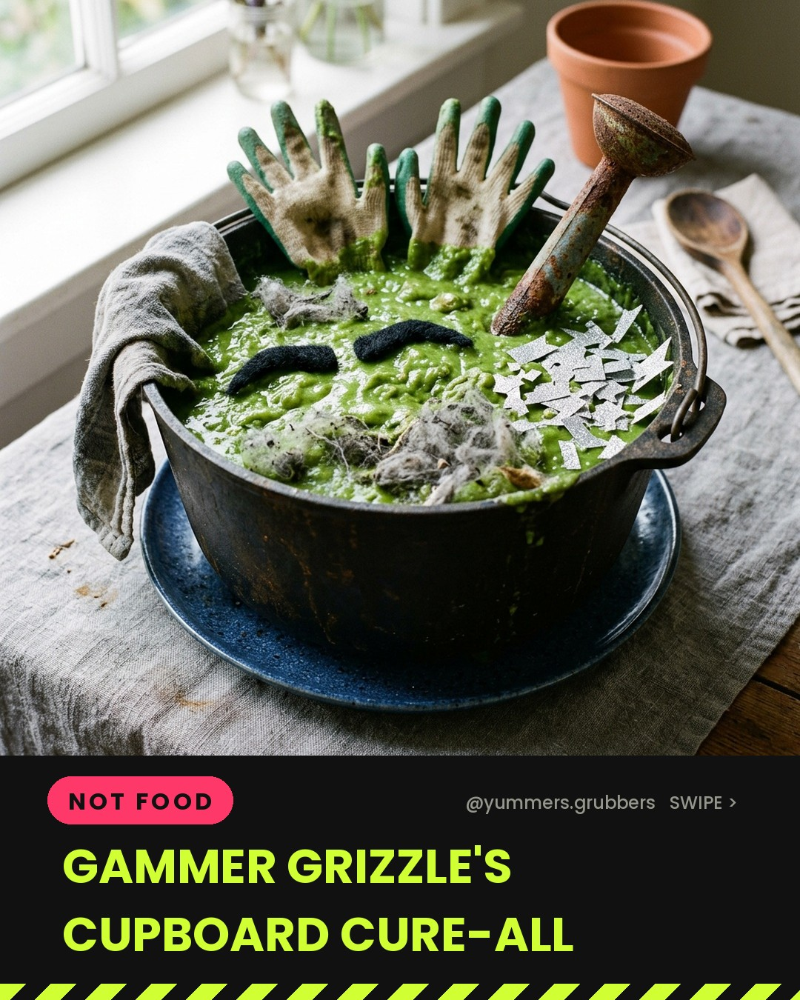
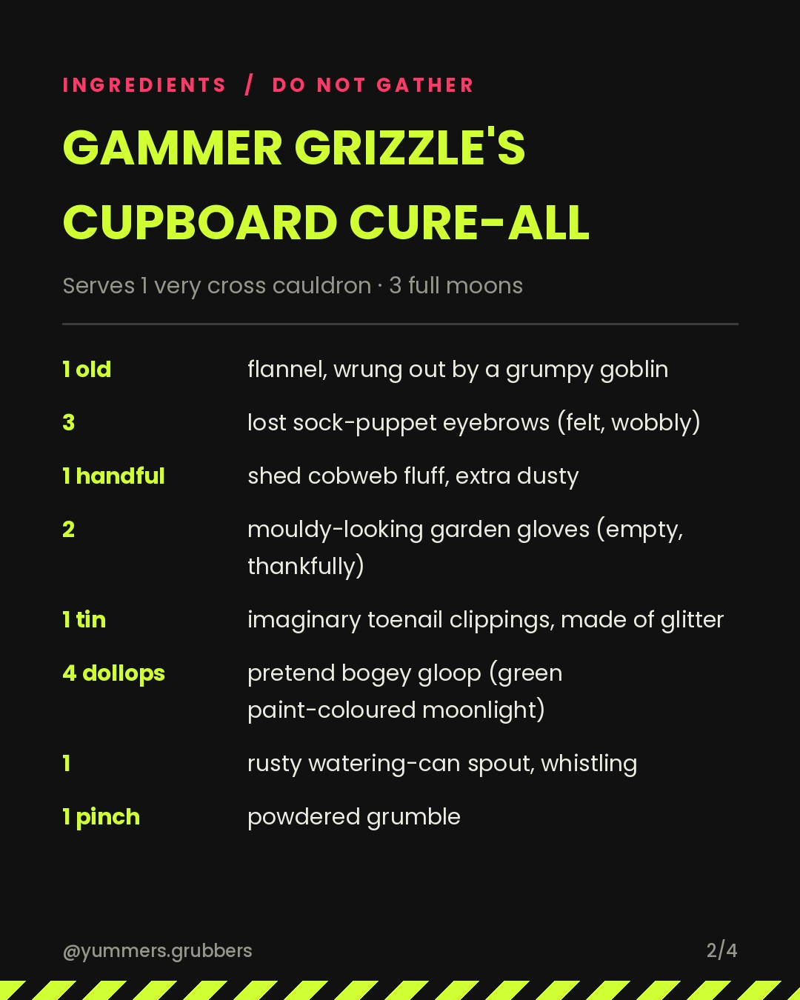
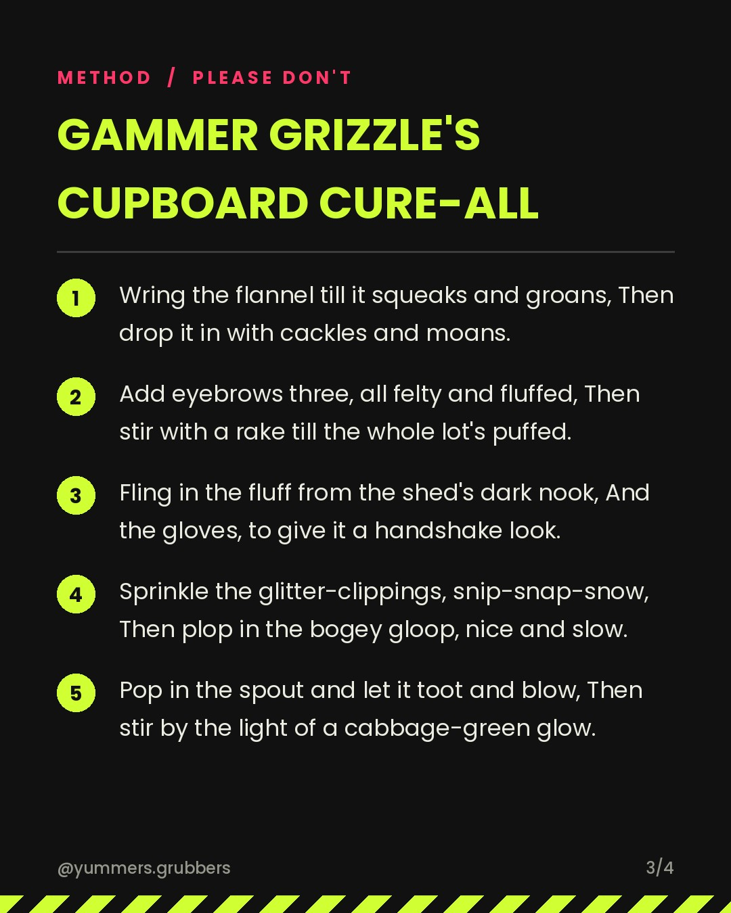

**Gammer Grizzle's Cupboard Cure-All** · `not_edible`

   

### Caption
```
Into the cauldron, a flannel, soggy and grey,
Wrung by a goblin who's had a bad day!
Three felty eyebrows, all wobbly and bent,
Plus cobweb fluff from the shed, dust-scented.
Garden gloves waving, so floppy and green,
Glittery toenails, the grandest I've seen!
Bogey-green gloop in four dollops, plip-plop,
A whistling spout, then I stir till I drop!
Pinch of powdered grumble, a cackle, a cough,
Gammer's Cure-All! Now stand well off!

Swipe for the spell 👉

#YummersGrubbers #WitchsSpell #JokeRecipe #GrossFood #CauldronCooking #SpookyKitchen #NastyRhymes #MarvellousMess #aifood #airecipes
```

**Reject:** add the `reject` label before the publish time and it will be skipped.
**Approve:** do nothing. It posts automatically.
