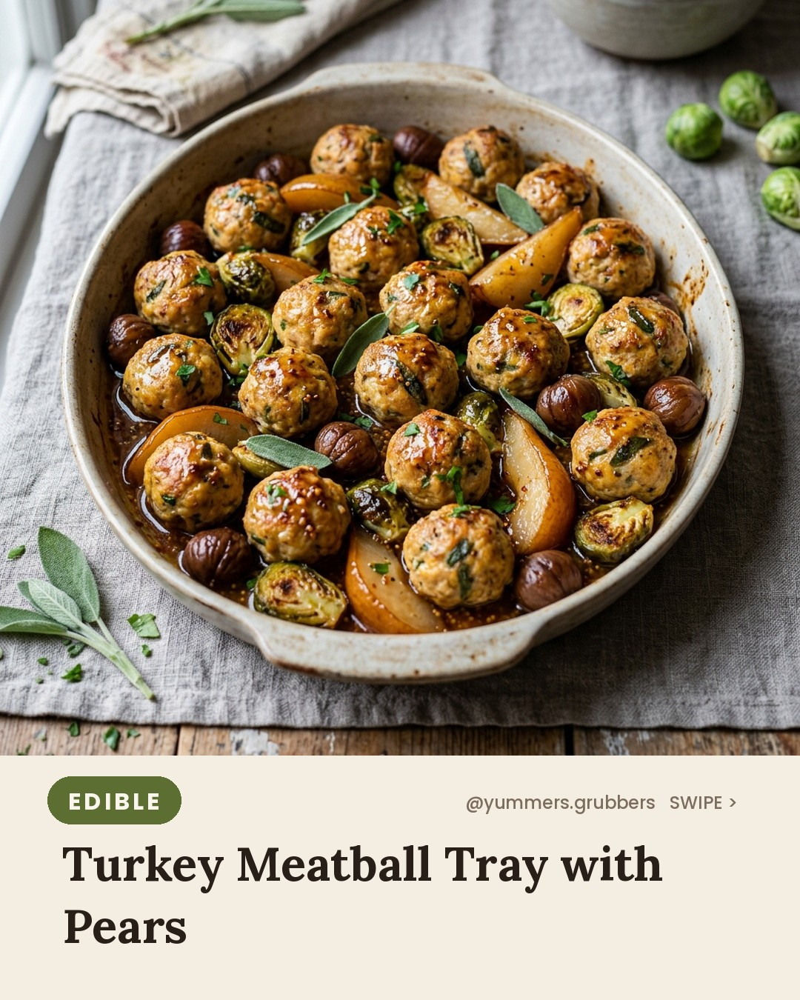
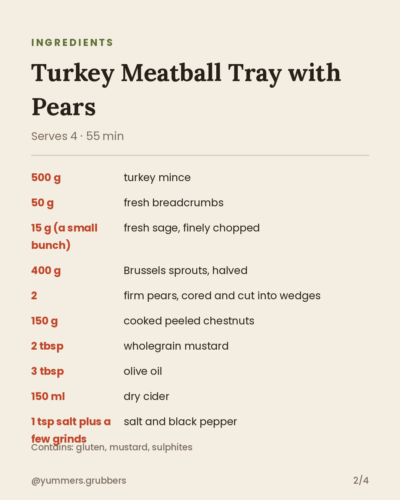
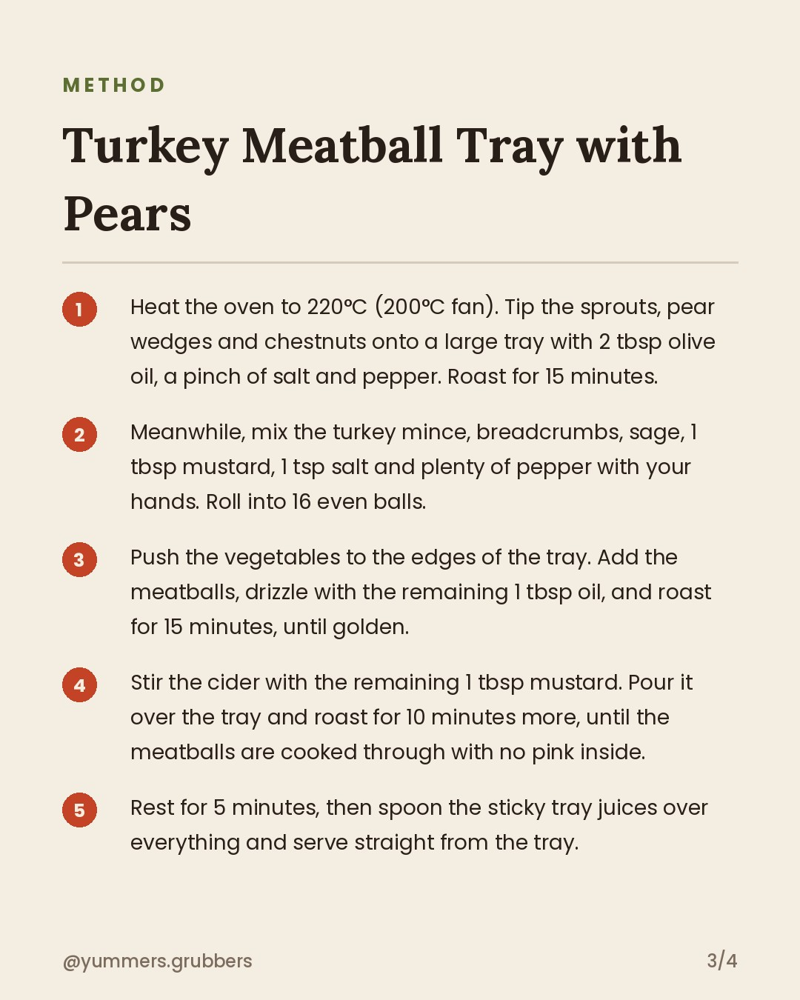
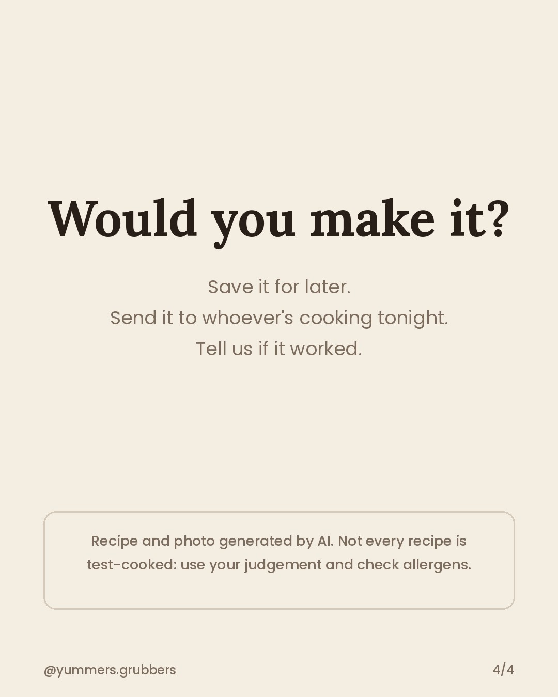

**Turkey Meatball Tray with Pears** · `edible` · 🦃 Thanksgiving theme

## 📲 You post this one (it's a "Yummy - Justin Bieber" day)
1. **[Download the Reel](https://v3b.fal.media/files/b/0ab40b2b/7faDxgh7Hn750bmhzzcUA_reel.mp4)** on your phone: open the link, then Share → **Save Video**.
2. Copy the caption below.
3. Instagram (as yummers.grubbers) → ➕ → **Reel** → pick the video → **Add audio** → search **Yummy - Justin Bieber** → choose the catchy part → Next → paste the caption → **Share**.
4. Close this issue when it's live.

The bot won't post it, and you'll get a reminder at the usual posting time.

   

### Caption
```
All the bits you actually want from a Thanksgiving plate, minus the six-hour sulk in the kitchen. Stuffing flavours, rolled into meatballs.

What's the one thing on your table that you'd happily eat on its own?

Serves 4 · 55 min
Contains: gluten, mustard, sulphites
Pause to read the full recipe ⏸️

#thanksgiving #friendsgiving #yummersgrubbers #turkeymeatballs #traybake #brusselssprouts #autumncooking #chestnuts #weeknightdinner #aifood #airecipes
```

**Reject:** add the `reject` label before the publish time and it will be skipped.
**Approve:** do nothing. It posts automatically.
